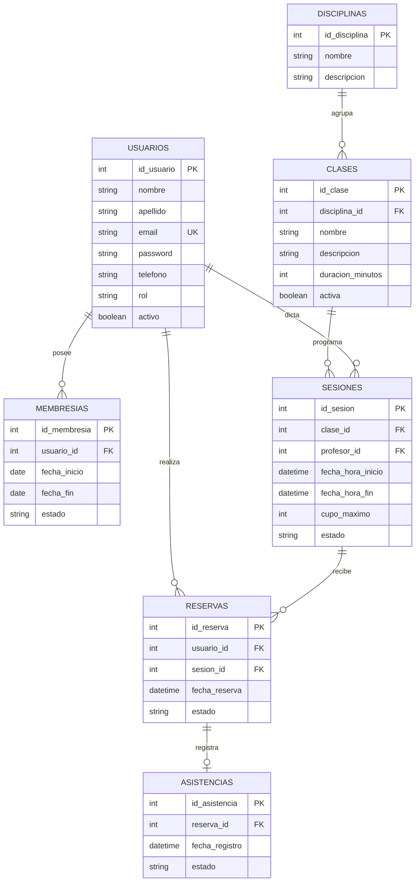

# Trabajo Final Integrador

Prototipo navegable (mock) para la cursada. El frontend consume una API simulada, sin
movimientos reales en base de datos, de modo que los mocks puedan reemplazarse por
consultas reales sin cambiar el frontend.

## Estructura del repositorio

```
.
├── backend/     # API REST con Express
└── frontend/    # SPA con React + Vite
```

Cada carpeta es un proyecto Node independiente, con su propio `package.json`,
`package-lock.json`, configuración de ESLint, `sample.env` y `README.md`.

## Requisitos

- Node.js `^20.19.0 || >=22.12.0` (se validó con Node 24.15)
- npm >= 10

## Puesta en marcha

Consultar los README de cada carpeta:

- [`backend/README.md`](backend/README.md)
- [`frontend/README.md`](frontend/README.md)

## Estrategia de ramas

| Rama | Uso |
| --- | --- |
| `master` | Producción |
| `develop` | Desarrollo e integración |
| `rama-por-alumno` | Trabajo individual de cada integrante |

Los cambios se integran primero en `develop` y luego se promueven a `master`.

## Estado actual

- Backend: servidor Express con CORS, respuestas HTTP unificadas, endpoints mock
  de autenticación (`/api/v1/auth/*`) y CRUD mock de membresías
  (`/api/v1/membresias`).
- Frontend: login, registro, recuperación, menú principal y módulo completo de
  membresías (listado con filtros/paginado, alta, detalle, edición y baja).
  Clases y Perfil siguen como placeholders. Mocks locales activos por defecto
  (`VITE_USE_MOCKS=true`).

Sin base de datos: todo es simulado y preparado para reemplazarse por consultas reales.

# Modelo Entidad-Relación (DER) – Bahía Gym

## 1. Descripción

El sistema de gestión de Bahía Gym utiliza una base de datos relacional para administrar usuarios, membresías, disciplinas, clases, sesiones, reservas y asistencias.

El modelo contempla tres roles principales: **Administrador, Profesor y Usuario (socio)**.

## 2. Diagrama Entidad-Relación



## 3. Descripción de las entidades

| Entidad | Descripción |
|---|---|
| **USUARIOS** | Almacena los datos de socios, profesores y administradores. |
| **MEMBRESIAS** | Registra las membresías de los socios, incluyendo fechas de inicio, vencimiento y estado. |
| **DISCIPLINAS** | Contiene las actividades ofrecidas por el gimnasio, como Pilates, Yoga, Funcional, Spinning y Cross Training. |
| **CLASES** | Define los tipos de clases disponibles y su duración. |
| **SESIONES** | Representa una clase programada para una fecha y horario específicos, con un profesor asignado y un cupo máximo de participantes. |
| **RESERVAS** | Registra las inscripciones de los socios a las diferentes sesiones. |
| **ASISTENCIAS** | Permite registrar si un socio asistió a una sesión reservada. |

## 4. Relaciones entre entidades

- **USUARIOS - MEMBRESIAS (1:N):** un usuario puede tener varias membresías a lo largo del tiempo.
- **DISCIPLINAS - CLASES (1:N):** una disciplina puede contener diferentes tipos de clases.
- **CLASES - SESIONES (1:N):** una clase puede programarse en diferentes fechas y horarios.
- **USUARIOS - SESIONES (1:N):** un profesor puede estar asignado a múltiples sesiones.
- **USUARIOS - RESERVAS (1:N):** un socio puede realizar múltiples reservas.
- **SESIONES - RESERVAS (1:N):** una sesión puede recibir múltiples reservas.
- **RESERVAS - ASISTENCIAS (1:0..1):** una reserva puede tener un único registro de asistencia.

## 5. Reglas de negocio

1. Un usuario debe tener una membresía vigente para poder realizar reservas.
2. Un socio no puede reservar dos veces la misma sesión.
3. La cantidad de reservas activas no puede superar el `cupo_maximo` establecido en la sesión.
4. Al cancelar una reserva, el lugar debe volver a estar disponible.
5. Un profesor no puede estar asignado a dos sesiones que se superpongan en el tiempo.
6. Las sesiones canceladas no deben permitir nuevas reservas.
7. Se debe conservar el historial de reservas y membresías.
8. La asistencia solamente puede registrarse para una reserva existente.

## 6. Consideraciones de diseño

- Los tres roles del sistema se gestionan desde una única entidad `USUARIOS`.
- La entidad `MEMBRESIAS` se mantiene independiente para conservar el historial de membresías de cada socio.
- Por el momento, existe un único tipo de membresía, por lo que no se incorpora una entidad de planes.
- El cupo máximo se define individualmente para cada sesión, permitiendo que una misma clase tenga distintas capacidades según el horario.
- La entidad `SESIONES` representa cada ocurrencia concreta de una clase programada.
